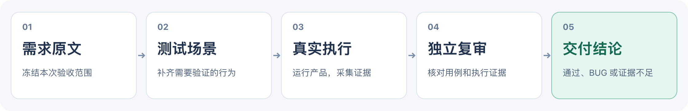
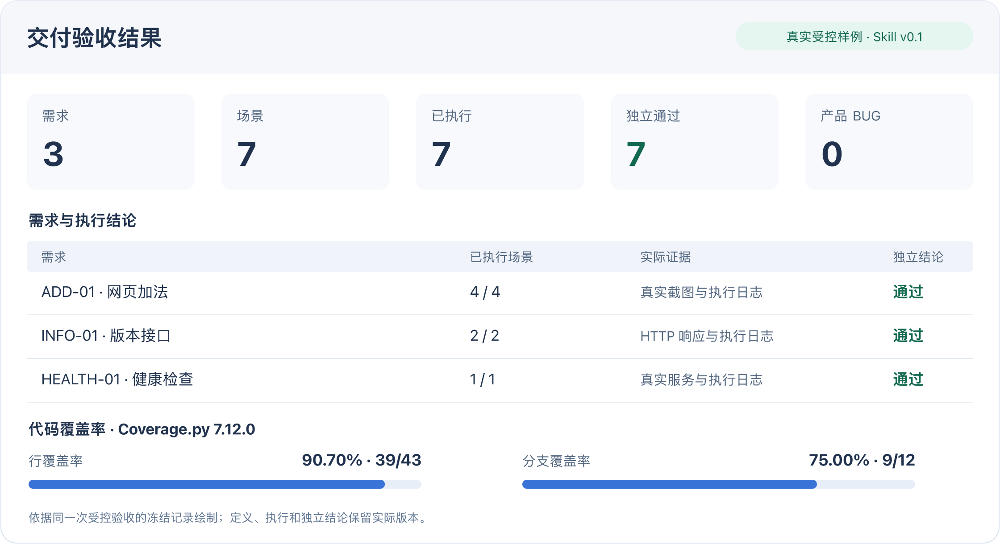

# App Delivery Acceptance

**交付前，验证每条需求是否真正实现。**

交给 Codex、Claude Code 或 OpenCode 一条需求，得到真实测试、独立复审和可追溯的验收结果。

[开始第一个 Demo](#跑通第一个-demo) · [预览验收结果](#先看结果) · [查看测试集](#测试集与识别结果)



## 为什么使用这个 Skill

| 交付时的问题 | 它提供的能力 |
| --- | --- |
| 需求有没有漏测？ | 串起需求、场景和用例，显示覆盖缺口 |
| 测试通过，结果可信吗？ | 真实运行产品，再由独立会话核查用例、日志和截图 |
| 需求变了，哪些需要重测？ | 识别受影响场景，增量复验，保留旧定义和旧结论 |

## 先看结果



[放大结果图](skills/en/app-delivery-acceptance/assets/docs/result-summary.png) · [查看该次验证范围](skills/en/app-delivery-acceptance/references/benchmark.md#v01-合并后受控回归摘要)

*上图依据一次 v0.1 受控验收的真实数据绘制。Web 看板还能展开执行日志、冻结截图和历史记录。*

## 跑通第一个 Demo

**准备环境：** macOS / Linux，Python 3、Git、Node.js >=22 与 npm；Codex、Claude Code 或 OpenCode 已能调用模型。首次会下载依赖并多次调用模型。[环境与排障说明](skills/en/app-delivery-acceptance/README.md#使用环境)

OpenCode 适配在当前源码版本提供；下方 `v0.1` 发布版本的安装示例不包含本次新增适配。使用当前源码的 OpenCode 用户需将该 Skill 挂载到 `.opencode/skills/app-delivery-acceptance`，并按[运行配置](skills/en/app-delivery-acceptance/references/agent-runtime.md)传完整模型 ID 和现有认证环境。

### 第 1 步：安装 Skill

执行与你的 Agent 对应的一条命令：

**Codex**

```sh
npx skills@1.7.4 add \
  'https://github.com/yangbobo2021/app-delivery-acceptance.git#v0.1' \
  --skill app-delivery-acceptance -g -a codex --copy -y
```

**Claude Code**

```sh
npx skills@1.7.4 add \
  'https://github.com/yangbobo2021/app-delivery-acceptance.git#v0.1' \
  --skill app-delivery-acceptance -g -a claude-code --copy -y
```

**完成标志：** 安装器显示 `app-delivery-acceptance` 安装成功。无需先安装 SPEX，模型使用你的 Agent 现有配置。

### 第 2 步：准备 Demo 项目

Demo 是一个读取 CSV、按账号汇总金额的命令行应用。本次只验收 **INV-02：按账号准确汇总整数金额**。

下载固定版本的测试集，进入该项目：

```sh
git clone --branch baseline/2026-10-20-v1 --single-branch \
  https://github.com/yangbobo2021/app-delivery-acceptance-benchmark-six.git \
  acceptance-demo
cd acceptance-demo
git switch -c demo-acceptance
cd projects/python-cli
```

**完成标志：** 当前目录中有应用代码、`README.md` 和 `docs/requirements.md`。

### 第 3 步：发起验收

在上一步目录打开 Agent 的新对话，复制这段任务：

```text
使用 app-delivery-acceptance Skill，验收当前项目 docs/requirements.md 中的 INV-02。
冻结需求完整定义，采用适用的已有场景，为缺口生成场景，执行该需求对应的全部场景并独立复审。
打开 Web 结果看板，展示场景、执行证据、独立结论和覆盖率状态，保留首次失败及历史记录。
本轮只验收 INV-02，不修改产品代码或 SPEC，不读取人工评测答案和历史结果来构造测试。
```

**完成标志：** 该需求的全部场景完成执行和独立复审，Agent 给出验收摘要与本地看板地址。

### 第 4 步：查看验收结果

打开 Agent 提供的 Web 地址，沿着“需求 → 场景 → 实际执行 → 独立结论”查看结果。页面每 5 秒刷新；若页面未打开，告诉 Agent：“打开当前项目本次验收的 Web 看板。”

**完成标志：** 能看到每个已执行场景的结论和证据。Demo 含预置缺陷，正确结果可以是 **产品 BUG**；证据不足会明确保留为受阻或待处理。

换成自己的项目时，跳过第 2 步，在任务中给出项目位置和一条明确需求即可。已有场景可直接采用，没有 SPEC 可从口头需求开始。

[更多安装与排障](skills/en/app-delivery-acceptance/README.md#更多安装与排障) · [Agent 执行规约](skills/en/app-delivery-acceptance/SKILL.md) · [资料与历史如何保存](skills/en/app-delivery-acceptance/references/project-acceptance-store.md)

## 测试集与识别结果

**测试集：** [app-delivery-acceptance-benchmark-six](https://github.com/yangbobo2021/app-delivery-acceptance-benchmark-six) · **组织：** 6 个独立项目，各 6 条书面需求 · **基线：** `baseline/2026-10-20-v1`

| 项目 / 接口 | 预置或注入的 BUG 类型（本次抽样） | 已识别 / 所选已知 BUG |
| --- | --- | ---: |
| Python / CLI | 合法金额汇总发生整数溢出 | 1 / 1 |
| Go / HTTP API | 重启后重试请求，重复扣减库存 | 1 / 1 |
| TypeScript / Web | 全局计数错误；完成项文字不可读 | 2 / 2 |
| Electron / 桌面 | 同名笔记误删；列表文字过小 | 2 / 2 |
| Java / 批处理 | 非相邻重复事件被重复计数 | 1 / 1 |
| Rust / TUI | 选中项文字与背景混在一起 | 1 / 1 |

**公开抽样结果：14 个场景已执行，识别 8 个已知 BUG，6 个正常对照通过。**

该轮生成 159 个场景，145 个未执行；覆盖 5 个功能缺陷和 3 个可读性缺陷，其中 2 个视觉缺陷由独立注入提交引入。结果来自较早的 Skill 提交 `c6ef951`，不等于 v0.1 的全量成绩。[查看固定版本、完整报告与复现范围](skills/en/app-delivery-acceptance/references/benchmark.md)
